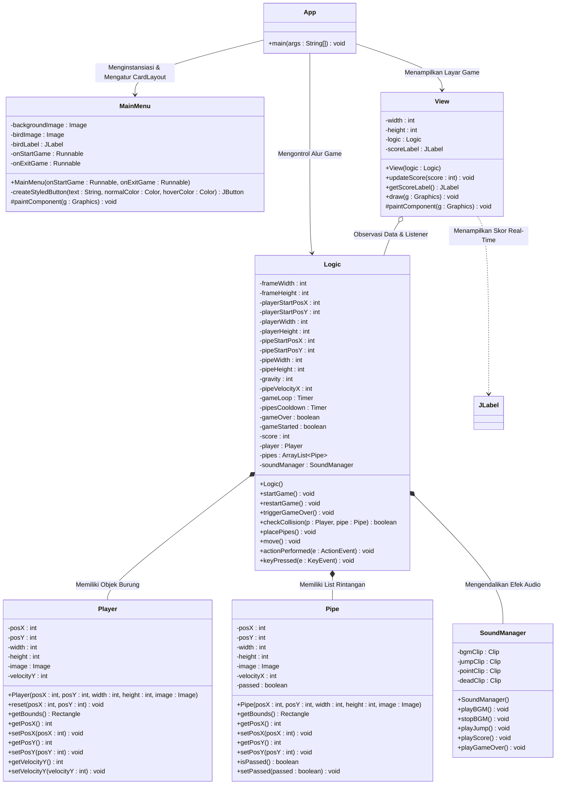
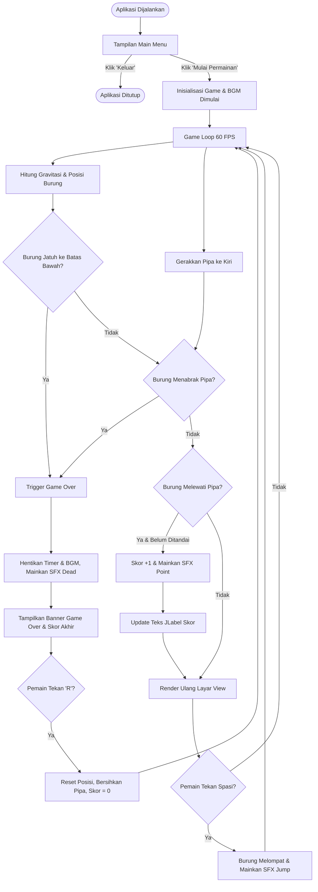
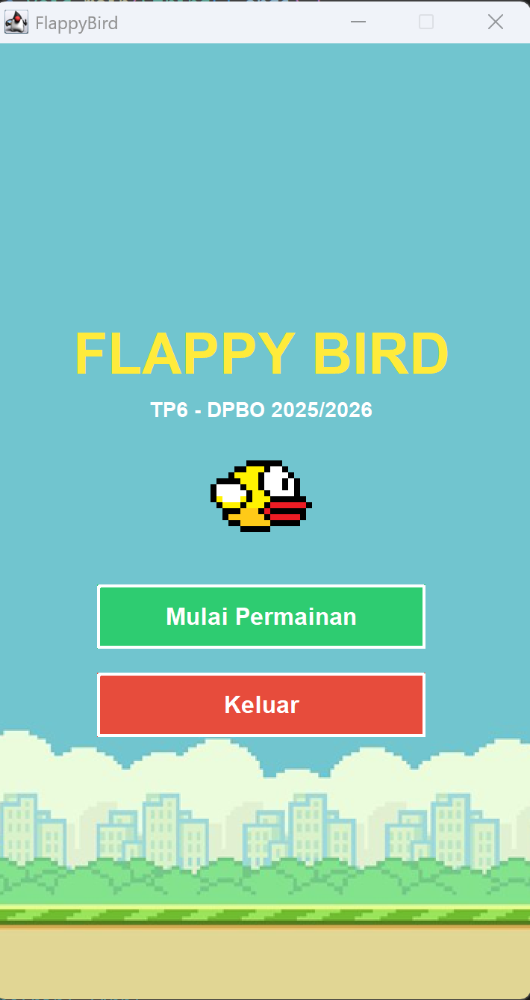
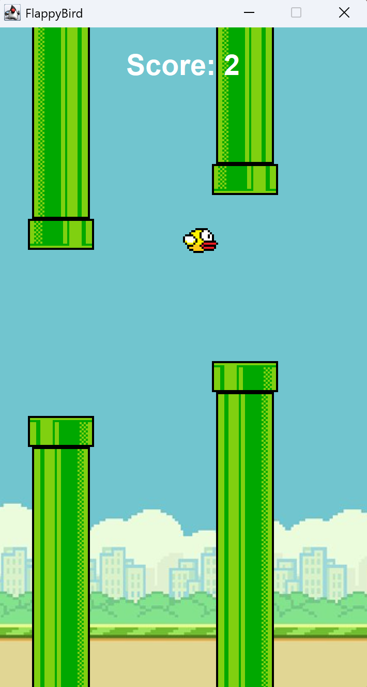
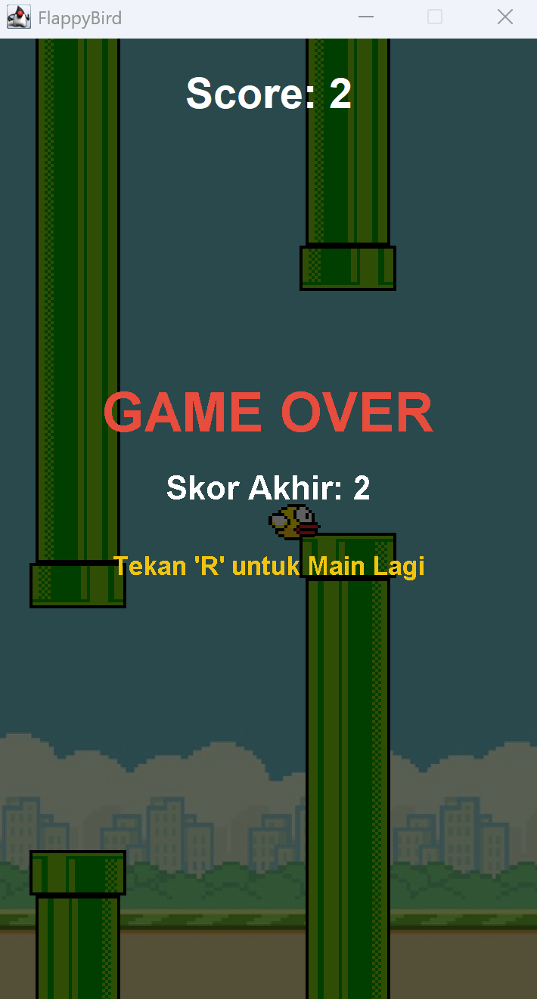

# Tugas Praktikum 6 DPBO 2526 C2 (TP6DPBO2526C2)
Game **Flappy Bird** berbasis **Java Swing GUI** dengan arsitektur berorientasi objek (OOP), animasi berbasis Timer game loop (60 FPS), deteksi tabrakan presisi (*AABB Collision*), antarmuka Main Menu, kalkulasi skor real-time menggunakan `JLabel`, serta integrasi audio latar (**BGM**) dan efek suara (**SFX**) penuh.

---

## Janji

> Saya Muhammad Zidan Mirza Fedrieka dengan NIM 2507692 mengerjakan Tugas Praktikum 6 dalam mata kuliah Desain Pemrograman Berorientasi Objek untuk keberkahan-Nya maka saya tidak melakukan kecurangan seperti yang telah dispesifikasikan. Aamiin.

---

## 1. Desain dan Fungsi Program

### A. Deskripsi Umum dan Pemisahan Tanggung Jawab (*Separation of Concerns*)
Aplikasi ini merupakan reka ulang (*remake*) dari game **Flappy Bird (2013)** yang dibangun menggunakan antarmuka grafis Java Swing. Seluruh sistem dirancang menerapkan prinsip pemrograman berorientasi objek (*Object-Oriented Programming*) dengan memisahkan kode ke dalam modul-modul independen:
- **Model Data Entitas (`Player`, `Pipe`)**: Merepresentasikan karakteristik, ukuran, koordinat, gambar, dan hitbox karakter serta rintangan.
- **Komponen Presentasi Kanvas (`View`)**: Mengelola rendering grafis 60 FPS di atas `JPanel` dan menampung komponen `JLabel` skor real-time.
- **Pengendali Alur & Fisika (`Logic`)**: Mengatur timer game loop, gravitasi, pergerakan pipa, deteksi tabrakan, status game over, serta pendengar input keyboard (`KeyListener`).
- **Pengelola Audio (`SoundManager`)**: Mengendalikan pemutaran musik latar belakang (*BGM looping*) dan efek suara aksi (*SFX*).
- **Antarmuka Menu Awal (`MainMenu`)**: Menyajikan menu permulaan game berdesain retro dengan tombol interaktif sebelum memasuki gameplay.
- **Pengatur Jendela Aplikasi (`App`)**: Menginisialisasi `JFrame` dan mengatur pergantian layar menggunakan `CardLayout`.

---

### B. Diagram Class

Program **Flappy Bird** tersusun dari 7 kelas yang saling berinteraksi:

---

### C. Penjelasan Class, Atribut, dan Method

#### 1. Class `App` (`App.java`)
Sebagai *entry point* utama program (`public static void main`):
- Menginisialisasi jendela utama `JFrame` berdimensi $360 \times 640$ piksel, posisi tengah layar (`setLocationRelativeTo(null)`), dan non-resizable.
- Membangun container utama berbasis `CardLayout` untuk menampung dua panel: `"MENU"` (`MainMenu`) dan `"GAME"` (`View`).
- Menghubungkan callback tombol *Mulai Permainan* untuk berpindah ke kanvas game, memberikan fokus keyboard (`requestFocusInWindow()`), dan memicu `logika.startGame()`.

#### 2. Class `MainMenu` (`MainMenu.java`) -
Panel antarmuka menu awal yang tampil saat game pertama kali dijalankan:
- `backgroundImage` (`Image`): Gambar latar belakang bertema langit dan perumahan retro (`background.png`).
- `birdImage` (`Image`): Sprite karakter burung (`bird.png`).
- `birdLabel` (`JLabel`): Menampilkan ikon burung berskala tajam di tengah panel secara proporsional tanpa tertimpa teks.
- `btnStart` & `btnExit` (`JButton`): Tombol dengan efek *hover mouse* untuk memulai sesi permainan atau menutup aplikasi (`System.exit(0)`).

#### 3. Class `Player` (`Player.java`)
Model data untuk karakter burung:
- `posX`, `posY` (`int`): Titik koordinat horizontal dan vertikal karakter.
- `width`, `height` (`int`): Ukuran sprite burung ($34 \times 24$ px).
- `image` (`Image`): Aset gambar visual karakter burung.
- `velocityY` (`int`): Kecepatan pergerakan vertikal yang dipengaruhi oleh gravitasi dan loncatan.
- `getBounds()` (`Rectangle`): Menghasilkan kotak pembatas (*bounding box*) untuk deteksi tabrakan.
- `reset(int posX, int posY)` (`void`): Mengembalikan koordinat dan kecepatan vertikal burung ke posisi awal saat restart.

#### 4. Class `Pipe` (`Pipe.java`)
Model data untuk rintangan pipa:
- `posX`, `posY` (`int`): Titik koordinat pipa.
- `width`, `height` (`int`): Ukuran dimensi pipa ($64 \times 512$ px).
- `image` (`Image`): Gambar visual pipa atas atau pipa bawah.
- `velocityX` (`int`): Kecepatan laju geser pipa ke arah kiri ($pipeVelocityX = -2$).
- `passed` (`boolean`): Flag penanda apakah pasangan pipa ini telah dilewati burung atau belum (mencegah penambahan skor berulang).
- `getBounds()` (`Rectangle`): Menghasilkan kotak pembatas pipa untuk kalkulasi interseksi tabrakan.

#### 5. Class `Logic` (`Logic.java`)
Pusat kendali logika fisika permainan, game loop, deteksi event, dan state management:
- `gameLoop` (`Timer`): Timer berkecepatan 60 FPS ($16.6$ ms per tick) yang memanggil method `actionPerformed()` untuk memindahkan objek dan merender ulang kanvas.
- `pipesCooldown` (`Timer`): Timer berinterval $1500$ ms ($1.5$ detik) untuk memunculkan sepasang pipa baru dengan celah ketinggian acak via `placePipes()`.
- `gravity` (`int = 1`): Nilai percepatan gravitasi bumi yang menarik burung ke bawah setiap frame.
- `score` (`int`): Akumulasi poin pemain yang bertambah $+1$ setiap berhasil melewati celah rintangan pipa.
- `gameOver` (`boolean`): Status apakah sesi permainan telah berakhir akibat tabrakan pipa atau jatuh ke dasar layar.
- `checkCollision(Player p, Pipe pipe)` (`boolean`): Algoritma *AABB Collision* untuk mendeteksi persinggungan antara batas karakter dan batas pipa dengan toleransi margin $2$ px.
- `restartGame()` (`void`): Mereset seluruh parameter (posisi burung, list pipa, skor kembali 0, status gameOver false) dan menyalakan kembali timer game.
- `keyPressed(KeyEvent e)` (`void`): Menangkap tombol **Spasi** untuk melompat ($velocityY = -9$) dan tombol **'R'** untuk merestart game setelah Game Over.

#### 6. Class `View` (`View.java`)
Kanvas grafis turunan `JPanel` yang merender keseluruhan permainan:
- `scoreLabel` (`JLabel`) - : Komponen teks penampil skor real-time di bagian atas layar dengan warna putih tebal dan background transparan.
- `draw(Graphics g)` (`void`): Menggambar background langit, iterasi kumpulan pipa, karakter burung, serta overlay Game Over semi-transparan hitam beserta skor akhir saat pemain kalah.

#### 7. Class `SoundManager` (`SoundManager.java`)
Pengelola audio menggunakan Java Sound API (`javax.sound.sampled`):
- `bgmClip` (`Clip`): Memutar musik latar belakang (`bgm.wav`) secara berulang (*loop continuously*).
- `jumpClip` (`Clip`): Memutar efek suara kepakan sayap (`jump.wav`) saat tombol Spasi ditekan.
- `pointClip` (`Clip`): Memutar efek suara denting koin (`point.wav`) saat skor bertambah.
- `deadClip` (`Clip`): Memutar efek suara benturan/kalah (`dead.wav`) saat Game Over terjadi.

---

## 2. Penjelasan Alur Program

### A. Diagram Alir Permainan (Flowchart)

---

### B. Mekanisme Kunci Permainan

1. **Transisi Layar Menggunakan `CardLayout`**
   - Saat aplikasi pertama kali dibuka, jendela menampilkan panel `MainMenu` yang berisi judul retro, karakter burung di tengah, tombol *Mulai Permainan*, dan tombol *Keluar*.
   - Mengklik tombol *Mulai Permainan* secara mulus menukar tampilan ke kanvas `View`, langsung memberikan fokus keyboard (`requestFocusInWindow()`), dan memutar musik latar *BGM*.

2. **Simulasi Gravitasi dan Loncatan:**
   - Di setiap tick game loop (60 kali per detik), kecepatan vertikal burung ditambah percepatan gravitasi (`velocityY += gravity`).
   - Penekanan tombol **Spasi** memberikan gaya dorong ke atas secara instan (`velocityY = -9`) dan memutar efek suara *jump*.

3. **Pencegahan Jatuh Tak Terhingga**
   - Saat burung menyentuh lantai batas bawah layar (`player.getPosY() + player.getHeight() >= frameHeight`), posisinya ditahan tepat di dasar frame dan memicu Game Over seketika. Burung tidak akan menembus ke luar batas jendela.

4. **Deteksi Tabrakan Presisi (*AABB Collision*):**
   - Tabrakan diperiksa antara hitbox `Player` dan setiap elemen `Pipe`. Diberikan toleransi margin 2 piksel agar benturan terasa adil bagi pemain. Begitu tabrakan terdeteksi, timer dihentikan, BGM dimatikan, dan SFX *dead* dibunyikan.

5. **Kalkulasi Skor Akurat via `JLabel`**
   - Karena pipa atas dan pipa bawah muncul berpasangan dengan koordinat horizontal $X$ yang persis sama, penambahan skor dikunci hanya melalui `upperPipeImage`. Hal ini menjamin skor bertambah tepat $+1$ per rintangan yang berhasil dilewati dan langsung diperbarui pada komponen `scoreLabel`.

6. **Mekanisme Restart Permainan**
   - Saat berada dalam status Game Over, penekanan tombol **'R'** pada keyboard akan memanggil `restartGame()`. Karakter burung kembali ke tengah layar, semua pipa dibersihkan, skor di-reset ke 0, BGM diputar kembali, dan kedua timer dijalankan ulang secara otomatis.

---

## 3. Dokumentasi Program Saat Dijalankan

> Bukti tangkapan layar antarmuka permainan, demonstrasi fungsionalitas game loop, deteksi tabrakan (Game Over), skor real-time, serta rekaman video pengujian:

### 1. Tampilan Main Menu

### 2. Gameplay & Penambahan Skor Real-Time

### 3. Tampilan Game Over & Skor Akhir

### 4. Rekaman Video Pengujian (Gameplay Demo)

- **Berkas Video:** [`Dokumentasi/gameplayrecord.mp4`](Dokumentasi/gameplayrecord.mp4)

<video src="Dokumentasi/gameplayrecord.mp4" controls width="360">
  
Browser Anda tidak mendukung pratinjau video langsung. Silakan tonton atau unduh file rekaman melalui tautan berikut: <a href="Dokumentasi/gameplayrecord.mp4">Dokumentasi/gameplayrecord.mp4</a>.

</video>

---
